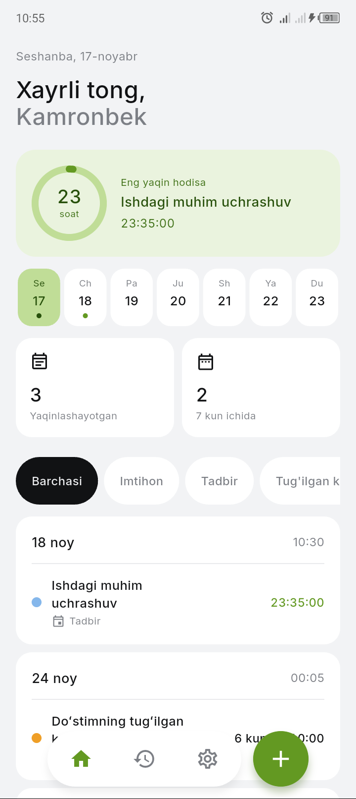
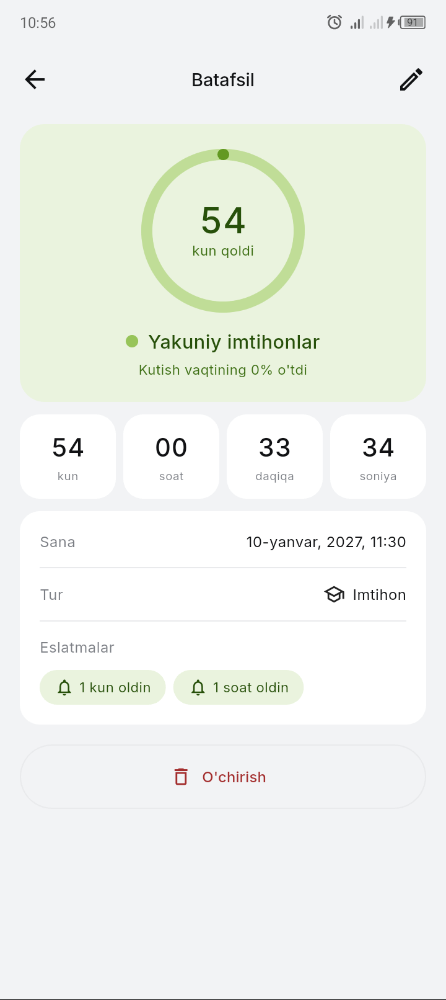
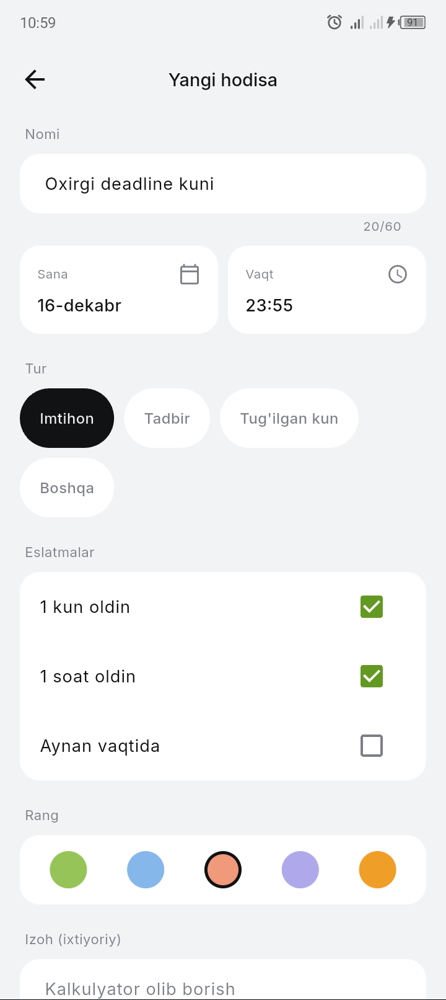
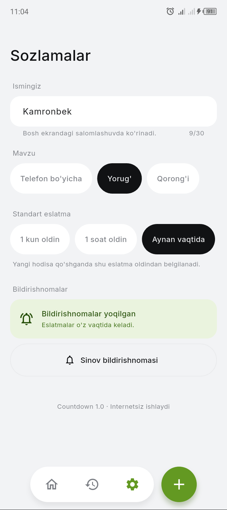
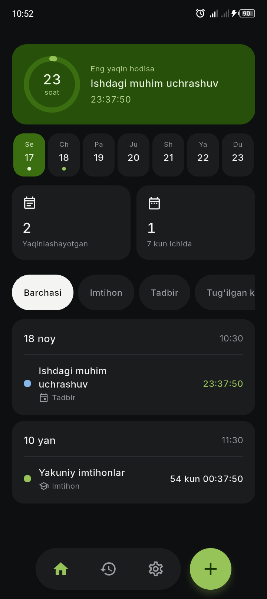

# Countdown — imtihon va muhim sanalar sanog'i

**Countdown** — imtihonlar, tadbirlar va tug'ilgan kunlargacha qolgan vaqtni real vaqtda sanab boradigan Android ilovasi. Hodisa sanasini kiritasiz, ilova qolgan kun, soat, daqiqa va soniyani har soniyada ko'rsatadi va sana yaqinlashganda bildirishnoma yuboradi. Ilova **to'liq oflayn** ishlaydi: internet, server yoki Firebase ishlatilmaydi, barcha ma'lumotlar telefonning o'zida saqlanadi.

> Mobil ilovalarni ishlab chiqish fani, amaliy ish, 23-variant.
> Talaba: **Ruzikulov Kamronbek Farxodovich**.

## Skrinshotlar

| Bosh ekran | Batafsil | Qo'shish | Sozlamalar | Qorong'i mavzu |
|---|---|---|---|---|
|  |  |  |  |  |

## Imkoniyatlar

- **Bir nechta hodisa**: nom, sana va vaqt, tur (Imtihon / Tadbir / Tug'ilgan kun / Boshqa), izoh, rang.
- **Real vaqtda sanoq**: `12 kun 04:31:09`. Barcha kartochkalar bitta umumiy taymerdan har soniyada yangilanadi.
- **Eng yaqin hodisa** kartochkasi: halqa kutish vaqtining qancha qismi o'tganini ko'rsatadi.
- **Hafta qatori**: keyingi 7 kun, hodisa bor kunlar nuqta bilan belgilangan.
- **Tur bo'yicha filtr** va **o'tgan hodisalar** alohida bo'limda.
- **Batafsil ekran**: kun / soat / daqiqa / soniya bloklari, o'zbekcha sana ("15-dekabr, 2026, 09:00"), tahrirlash va tasdiqlab o'chirish. Vaqti kelgan hodisa uchun "Hodisa boshlandi / o'tdi" holati.
- **Bildirishnomalar**: 1 kun oldin, 1 soat oldin va aynan vaqtida. Ular tahrirlashda qayta rejalashtiriladi, o'chirishda bekor qilinadi, telefon qayta yoqilganda tiklanadi.
- **Validatsiya**: nom bo'sh bo'lmasligi (60 belgigacha), sana o'tmishda bo'lmasligi, o'tib ketgan eslatma haqida ogohlantirish.
- **Sozlamalar**: ism (salomlashuvda chiqadi), yorug' / qorong'i / telefon bo'yicha mavzu, standart eslatma, bildirishnoma ruxsati holati va "Sinov bildirishnomasi".
- O'zbek tili (lotin), Material 3, Inter shrifti (ilova ichida, oflayn), kichik ekranlar va katta shrift uchun moslashgan.

## Texnologiyalar

| Texnologiya | Nima uchun |
|---|---|
| **Flutter 3.50 / Dart 3.14** | Bitta kod bazasi, tez ishlab chiqish, Material 3 tayyor komponentlari. |
| `sqflite` 2.4 + `path` | Hodisalar va sozlamalarni telefondagi lokal SQLite bazasida saqlash uchun. |
| `provider` 6.1 (`ChangeNotifier`) | Holatni boshqarish: ma'lumot o'zgarsa, ekranlar avtomatik yangilanadi. Sodda va tushunarli. |
| `flutter_local_notifications` 23.0 | Internetsiz, telefonning o'zida rejalashtiriladigan eslatmalar uchun. |
| `timezone` + `flutter_timezone` | Eslatma vaqtini telefonning vaqt mintaqasi (masalan, `Asia/Tashkent`) bilan to'g'ri rejalashtirish uchun. |
| `intl` | Sanani o'zbekcha formatda chiqarish uchun ("dekabr", "seshanba"). |

## Ishga tushirish

Talablar: Flutter SDK (3.50+), Android SDK (platforma 37), JDK 17, Android telefon yoki emulyator.

```bash
git clone https://github.com/kamrobekruzikulov785-wq/Countdown.git
cd Countdown
flutter pub get
flutter run
```

Testlar va kod tekshiruvi:

```bash
flutter analyze
flutter test
```

Yakuniy APK yaratish:

```bash
flutter build apk --release
```

Tayyor fayl: `build/app/outputs/flutter-apk/app-release.apk`.

> **Windows uchun eslatma:** agar Pub keshi (C:) va loyiha (D:) turli disklarda bo'lsa, Kotlin keshi xato berishi mumkin. Shuning uchun `android/gradle.properties` da `kotlin.incremental=false` yoqilgan.

## Loyiha tuzilmasi

Kod qatlamlarga ajratilgan: **model → ma'lumot (data) → provider → ekranlar (UI)**.

```
lib/
  main.dart                         # kirish nuqtasi: provider'lar, mavzu, o'zbek tili
  models/hodisa.dart                # Hodisa, HodisaTuri, EslatmaOraligi
  data/
    database_helper.dart            # sqflite: jadvallar, CRUD, versiya yangilanishi
    hodisa_repository.dart          # qatorlar <-> Hodisa obyektlari
    sozlamalar_repository.dart      # ism, mavzu, standart eslatma
  services/notification_service.dart  # eslatmalarni rejalashtirish va bekor qilish
  providers/
    hodisa_provider.dart            # hodisalar ro'yxati, filtr, CRUD (ChangeNotifier)
    soat_provider.dart              # bitta umumiy Timer.periodic(1 soniya)
    sozlamalar_provider.dart
  screens/                          # home, past, detail, edit, settings
  widgets/                          # countdown_card, countdown_blocks, progress_ring,
                                    # next_event_card, week_strip, empty_state, ...
  utils/                            # countdown_format, sana_format, validators, eslatma_matni
  theme/app_theme.dart              # ranglar (yorug'/qorong'i) va shrift
  constants/                        # barcha o'zbekcha matnlar va belgilar
test/                               # 30 ta test: hisob-kitoblar, validatsiya, ekranlar (360 px)
```

Ma'lumot oqimi: **Ekran → Provider → Repository → DatabaseHelper → SQLite**.

## Sinov

- `flutter analyze`: 0 ta muammo.
- `flutter test`: 30 ta test. Ular sanoqni formatlash, validatorlar, eslatma vaqti va matnini tekshiradi. Bundan tashqari, barcha ekranlar 360 px kenglikda oddiy va 1,3 barobar katta shriftda sig'ishi tekshiriladi.
- Haqiqiy telefonda (Infinix HOT 30i, Android 12) qo'lda sinaldi: samolyot rejimida ishlash, ilova yopilib ochilganda ma'lumot saqlanishi, bo'sh nom va o'tgan sana xatolari, belgilangan vaqtda bildirishnoma kelishi.

## AI'dan foydalanish

Loyiha **Claude Code** (Anthropic) yordamida yozildi. Halol bayon:

- **AI bajargan qism:** ishlab chiqish muhitini o'rnatish (Flutter, Android SDK), dastur kodining asosiy qismi (model, baza, provider'lar, ekranlar, bildirishnomalar), testlar, kod izohlari, ushbu README va himoya qo'llanmasi. Har bir commit'da AI hammuallif sifatida ko'rsatilgan (`Co-Authored-By`).
- **Talaba bajargan qism:** dizayn yo'nalishini tanlash (3 ta referens yuborib, uslubni tasdiqlash), har bir bosqichni ko'rib chiqish va ruxsat berish, ilovani telefonda sinash va xatolarni topish. Masalan, vaqt tanlash oynasidagi xatoni talaba topdi. GitHub repozitoriyini ochish, qo'lda sinov ro'yxatini bajarish ham talabaning ishi.
- **Ish tartibi:** AI har bir qadamdan oldin nima qilishini tushuntirdi va ruxsat oldi. Topilgan xatolar va ularning yechimlari bosqichma-bosqich commit'larda saqlangan.

Kod sodda va har bir faylda o'zbekcha izohlar bor. Talaba kodni tushunishi va himoyada tushuntira olishi uchun [HIMOYA.md](HIMOYA.md) faylida ilovaning ishlash tartibi va o'qituvchi berishi mumkin bo'lgan savollarga javoblar tayyorlangan.

## Litsenziyalar

Inter shrifti — SIL Open Font License 1.1 ([assets/fonts/Inter-LICENSE.txt](assets/fonts/Inter-LICENSE.txt)).
